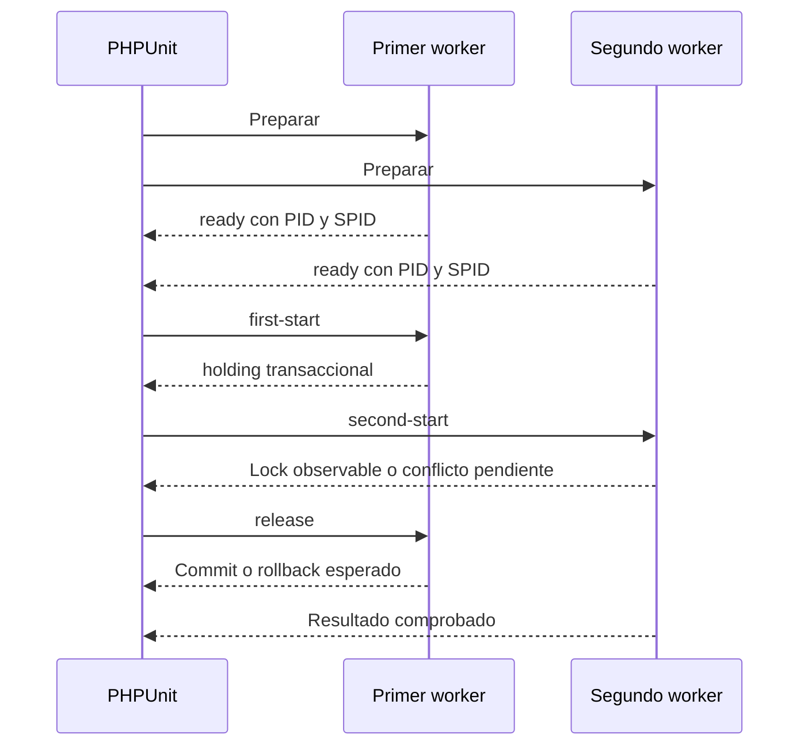

# Entrega 1.7a — Diagnóstico de intermitencia y repetibilidad

## A. Resumen ejecutivo

**ETAPA 1.7a: ACEPTADA CON OBSERVACIONES**. Se reprodujeron dos faltas de holding en una regresión completa de 904 casos, aunque la línea base y las baterías focalizadas habían pasado. Las trazas demostraron agotamiento del intervalo compartido de 15 s con workers aún en preparación o sin comenzar transacciones financieras. Se separaron ready/start y el presupuesto de preparación; no se aumentaron los límites financieros ni el techo de proceso. Se corrigió además la limpieza demostrada de tres clases. Después del cambio: 1092 casos sin fallos, incluida la suite final 906/11653. El origen último de las demoras del host y la equivalencia causal con todos los incidentes de 1.6f no están demostrados. Código productivo, datos operativos y diez archivos protegidos intactos.

## B. Línea base

Rama `main`, HEAD `a0fc5a5e8aef885479d9774b4c6cdef7b116781c`. Al inicio había 27 entradas seguidas modificadas y 39 sin seguimiento, incluido trabajo anterior de 1.6e/f. Se preservó. La nueva línea base ejecutó `composer test -- --log-junit .tools/stability-baseline-junit.xml`: **900 / 11625**, 45:39.511, 380 MB, salida 0. Calidad inicial: Pint, Larastan, Composer validate y plataforma, salida 0. Los resultados anteriores no sustituyen esta ejecución. PHP 8.3.36, Laravel 13.42.0, Windows/PowerShell y zona comercial America/Mexico_City; conexión integrada conservada.

## C. Incidentes

Históricos: `SaleDiscountsConcurrencyTest::test_independent_sql_http_connections_serialize_discount_intentions@two_discounts` (24/11), `CheckoutConcurrencyTest::test_independent_http_sql_sessions_protect_checkout_and_daily_sequence@two_keys` y `@same` (25/11). Síntoma: falta `holding`, antes de completar comprobaciones financieras. Clasificación: sincronización/causa desconocida; no demuestra por sí sola timeout, deadlock, arranque tardío ni fallo financiero. Incidente nuevo confirmado: directorios de Block05ConcurrencyTest, ReportsConcurrencyTest y SaleReceiptsConcurrencyTest no eliminados en `finally`. En esta etapa se reprodujeron Checkout two_keys y same en la regresión diagnóstica de 904 casos. Categoría: sincronización y timeout de preparación mezclado con barrera; mecanismo confirmado para esos dos casos, sin atribuir la demora a un componente del host.

## D. Evidencia

Se conservan los logs/JUnit históricos de 1.6f, ambas baterías previas, la [regresión de 904 casos con dos fallos](qa/1.7a/pre-gate-regression.log), las [trazas de reproducción](qa/1.7a/reproduced-failures.json), las regresiones posteriores y el resultado final. Los fallos antiguos de 1.6f no conservaron sus directorios de worker. En la reproducción actual sí hay estados del padre, códigos de salida después de limpieza, fases de PHP y duraciones monotónicas. En two_keys el worker no llegó a ready antes de los 15 s; en same llegó a conexión/ready a los 10.4 s y comenzó HTTP a los 10.9 s, pero no emitió holding antes del límite. Los procesos seguían vivos al fallar. El finally los terminó: su código posterior no debe confundirse con un crash espontáneo. Límite de correlación en two_keys: el trace temprano aún no incluía run ID y se asocia como candidato único por su ventana monotónica de lanzamiento y timeout; no se presenta como una cadena PID padre-hijo directamente observada. En same sí existe correlación explícita por run ID. La instrumentación corregida incorpora identidad antes de autoload.

## E. Hipótesis

La reproducción cambió el grado de certeza: ya hay evidencia del intervalo consumido durante preparación, pero no de su causa última. Los incidentes antiguos no conservan fases suficientes para atribuirles automáticamente el mismo origen.

| ID | Hipótesis | Conclusión | Certeza |
| --- | --- | --- | --- |
| H1 | Arranque tardío o planificación Windows | Preparación y barrera compartían un plazo; ready/start corrige esa dependencia. Origen último de la demora no atribuido. | Alta para el mecanismo reproducido; desconocida para el host |
| H2 | Respuesta HTTP antes de alcanzar la barrera | No explica la reproducción actual; resultados antiguos de 1.6f siguen irrecuperables. | Alta para los dos casos actuales; histórica desconocida |
| H3 | Bloqueo SQL o deadlock previo a holding | No se demuestra un deadlock financiero como causa de estos dos fallos; se mantienen pruebas de deadlock reales. | Limitada al alcance de las trazas |
| H4 | Cambio del reloj durante una espera | Los saltos registrados no coinciden con las ventanas fallidas. | Alta para esa no coincidencia; no descarta todo ajuste |
| H5 | Estado residual de archivos de carrera | Defecto de limpieza confirmado y corregido; causalidad con holding no demostrada. | Alta para limpieza, desconocida para holding |
| H6 | Presión de memoria/carga del entorno | Variación medida; no se demuestra causalidad ni se altera configuración. | Alta para condición observada, baja para causalidad |
| H7 | Crash nativo de PHP sin stderr | El exit code tras stop no se interpreta como crash espontáneo. Causa nativa histórica no demostrada. | Alta para la terminación controlada observada |
| H8 | Dependencia de orden, caché o estado de autenticación | Carga/orden del entorno no queda descartada como origen de demoras; no se demostró dependencia de datos entre pruebas. | Observación confirmada; causalidad última abierta |

[Matriz completa: síntoma, evidencia, experimento y resultado](qa/1.7a/hypotheses.json).

## F. Reproducción

Comando reproducible: `powershell.exe -NoProfile -ExecutionPolicy Bypass -File scripts/qa/test-stability.ps1`. Cuatro rondas por defecto, un runner, detención al primer resultado no satisfactorio. Tres datasets aislados, grupo de 25 normal/inverso, semillas aleatorias 1702/1703 y las demás clases de concurrencia. Se ejecutaron 20 comandos y 388 casos, con 0 fallos/errores funcionales observados. Una invocación terminó con salida 1 por una advertencia, conservada abajo.

| Intento/escenario | Casos | Aserciones | Salida | Resultado |
| --- | --- | --- | --- | --- |
| primer intento / historical-two-keys | 1 | 19 | 0 | Sin fallos |
| primer intento / historical-same | 1 | 18 | 0 | Sin fallos |
| primer intento / historical-discounts | 1 | 20 | 0 | Sin fallos |
| primer intento / combined-0-default | 25 | 474 | 1 | Advertencia de semilla en orden normal |
| batería previa a gates / historical-two-keys | 1 | 19 | 0 | Sin fallos |
| batería previa a gates / historical-same | 1 | 18 | 0 | Sin fallos |
| batería previa a gates / historical-discounts | 1 | 20 | 0 | Sin fallos |
| batería previa a gates / combined-0-default | 25 | 474 | 0 | Sin fallos |
| batería previa a gates / combined-1-reverse | 25 | 474 | 0 | Sin fallos |
| batería previa a gates / combined-2-random | 25 | 474 | 0 | Sin fallos |
| batería previa a gates / combined-3-random | 25 | 474 | 0 | Sin fallos |
| batería previa a gates / related-concurrency | 77 | 1460 | 0 | Sin fallos |
| batería posterior a gates / historical-two-keys | 1 | 19 | 0 | Sin fallos |
| batería posterior a gates / historical-same | 1 | 18 | 0 | Sin fallos |
| batería posterior a gates / historical-discounts | 1 | 20 | 0 | Sin fallos |
| batería posterior a gates / combined-0-default | 25 | 474 | 0 | Sin fallos |
| batería posterior a gates / combined-1-reverse | 25 | 474 | 0 | Sin fallos |
| batería posterior a gates / combined-2-random | 25 | 474 | 0 | Sin fallos |
| batería posterior a gates / combined-3-random | 25 | 474 | 0 | Sin fallos |
| batería posterior a gates / related-concurrency | 77 | 1460 | 0 | Sin fallos |

## G. Workers

PHP explícito, Symfony Process, cwd del repositorio y argumentos en arrays. Nuevas fases: lanzamiento desde el padre, conexión, ready, barrera, release, transacción/commit/rollback, consulta lenta sin SQL ni bindings, estado HTTP y shutdown. PID, SPID, escenario y run ID permiten correlación. Tiempos monotónicos con `hrtime`. La línea base recogió 53 trazas; la regresión final 53. El tiempo dentro de PHP no mide por sí solo el lanzamiento previo de Windows; ahora se registra también desde el padre. En la regresión final, ready interno mínimo/mediana/máximo: 377.029/589.811/745.049 ms; retorno de start máximo 38.545 ms. [Tiempos del padre y barreras](qa/1.7a/parent-timings.json). En Windows el PID del proceso devuelto por Symfony puede corresponder al envoltorio: el PHP real se identifica por su propio trace y ready JSON. Se registra el run/rol antes de autoload para no perder identidad si falla el bootstrap. La correlación temporal se apoya en [PHP 8.3.36, zend_hrtime](https://raw.githubusercontent.com/php/php-src/php-8.3.36/Zend/zend_hrtime.h) y [Microsoft QPC](https://learn.microsoft.com/es-es/windows/win32/sysinfo/acquiring-high-resolution-time-stamps); no se convierte ese contador en hora UTC.

## H. Barreras

Nuevo protocolo de pruebas: ambos workers necesarios arrancan y publican ready JSON mediante archivo temporal y rename; incluye run ID, rol, PID real y SPID. El padre verifica identidad y proceso vivo, espera ambos ready con un único presupuesto de preparación y entonces publica first-start. Solo tras holding publica second-start. Esto conserva el solapamiento SQL previsto y evita gastar la retención de la primera transacción en arrancar al segundo PHP. Los retries posteriores a commit/rollback mantienen su camino secuencial original. Se conservan todas las comprobaciones financieras, SPID diferentes y DMV LCK_M_*, o 409 pendiente. Se registra también el intento del lock de seguridad. No se usa sleep para simular disponibilidad; el polling técnico de 20 ms está limitado por estado y deadline.

Carrera paralela (rollback/lost mantienen su rama secuencial):

## I. Procesos Windows

Se revisaron proc_open/Symfony, bypass_shell, cwd, argumentos, herencia del entorno, salida y terminación. La batería usa PowerShell directo para evitar reinterpretar filtros con metacaracteres por local.cmd. Una sonda sin SQL conservó el código deliberado 7 y dejó el hijo terminado. El guard rechazó un segundo runner mientras existía PHPUnit del repositorio. No se finalizaron procesos ajenos ni el servidor 8080.

## J. SQL Server

Windows Authentication y SQL Server Express conservados. Pruebas únicamente en fresapos_test. READ COMMITTED, RCSI OFF y snapshot OFF observados, sin reconfigurar. Las carreras verifican conexiones independientes, bloqueos reales, deadlock 1205, rollback, replay y ausencia de duplicados con las pruebas existentes. DMV y system_health consultados sin SQL sensible; los timestamps del ring buffer no tienen retención completa ni atribución automática al incidente. Sin NOLOCK, restricciones desactivadas ni índices nuevos. La consulta filtrada del errorlog de paginación falló con QueryException; no se dispone de su contenido ni se infiere si fue por permisos, firma del procedimiento u otra causa. DMV y ring buffer sí aportaron metadatos.

## K. Estado residual

Defecto confirmado: tres clases detenían hijos pero dejaban barreras/resultados. La línea base creó seis directorios residuales. Se inventariaron y retiraron solo esos seis, tras terminar su runner. La corrección valida la ruta absoluta y prefijos propios, rechaza subdirectorios y enlaces, conserva diagnósticos internos de fallo excluyendo input y elimina el directorio tras detener sus procesos. Se añaden aserciones de ausencia y cuatro regresiones de seguridad/preservación. Los 66 directorios preexistentes de la captura inicial se conservan. Al cierre no quedan barreras nuevas de esta etapa; los archivos diagnósticos retenidos son evidencia intencional, no señales activas.

## L. Orden de pruebas

Los grupos normal, inverso y semillas 1702/1703 pasaron antes y después del cambio. La regresión completa anterior a gates sí reprodujo dos fallos; por tanto, el éxito focalizado no descarta interacción con carga/orden/estado global del entorno. No se demostró una dependencia de datos entre casos. Los fixtures comparten tablas y no admiten runners paralelos; el ejecutor lo rechaza. Se mantienen restauración de Carbon, guards, permisos y caché array.

## M. Timeouts

Cambio justificado de coordinación: preparación conjunta hasta 30 s, calculada dentro del techo existente de 45 s de proceso y separada de la barrera financiera de 15 s. Evidencia: el límite anterior de 15 s venció con un worker todavía arrancando y otro que consumió 10.4 s antes de ready. No se amplían trabajo financiero 15 s, observación de lock 8 s, retención 25 s, proceso 45 s, retry 35 s ni parada 1 s. Ahora checkTimeout se supervisa también mientras se espera readiness/barrera/lock, en vez de confiar solo en wait posterior. El worker espera start con límite propio de 45 s; ambos ya están preparados antes de retener la primera transacción. Hasta dos workers auxiliares concurrentes; un runner. Composer completo conserva 3600 s. Batería: no inicia otro comando tras 40 min, máximo 900 s por comando y cota total hasta 55 min. No hay bucle ni reintento oculto.

## N. Rendimiento

Fixture equivalente: 1001 ventas reales de servicios, distribución 300/700/1 y total confirmado 180180.0000. Primeras lecturas actuales preservadas aparte; veinte lecturas adicionales alternan tamaños. Query log está activo como en la referencia; registra cada duración y fingerprint/tablas, sin bindings. SQL reportado incluye driver/espera; la resta es estimación no SQL, no CPU PHP. Blade directo se mide aparte, sin red/navegador. No se vació caché global; caché fría SQL/PHP no se verificó. No se añadieron índices: el plan disponible es estimado, con scans clustered de un fixture pequeño, sin contadores reales de ejecución.

| Filas | Muestras | Consultas | Mín. aplicación ms | Mediana ms | Máx. ms | Mediana Blade ms |
| --- | --- | --- | --- | --- | --- | --- |
| 10 | 10 | 26 | 115.731 | 139.172 | 157.026 | 4.780 |
| 100 | 10 | 26 | 134.486 | 166.579 | 199.276 | 12.715 |

No se estima p95 estable con diez muestras por tamaño. Las diferencias frente a 61/56 y 225/172 ms no se atribuyen a código sin condiciones comparables y causalidad. [Mediciones completas](qa/1.7a/performance.json) y [recursos](qa/1.7a/resources.json).

## O. Causa raíz

Confirmado para la reproducción actual: el harness mezclaba preparación de procesos y llegada a una barrera financiera en el mismo intervalo de 15 s; venció mientras los procesos seguían vivos y sin alcanzar holding. Preparar ambos antes de dar start elimina esa dependencia temporal concreta. No se demostró qué componente del host originó las demoras (framework, disco, planificador, memoria o instrumentación), ni que todos los fallos históricos tuvieran exactamente la misma causa. Defecto independiente confirmado: tres finally no borraban sus directorios; corregido. El resultado se clasifica como mitigación validada del fallo reproducido, con causa última y riesgo residual documentados, no eliminación absoluta de intermitencia.

## P. Correcciones

Sin cambios productivos. Ocho archivos existentes de pruebas/fixtures modificados: diagnóstico, ready/start en Checkout/Discounts, supervisión de deadlines, limpieza en tres clases y medición opcional de Reports. Nuevos WorkerDiagnostics, ReportMeasurements, WorkerDiagnosticsTest y prepared-worker.php, este último sin SQL. Seis casos unitarios verifican preservación sin input, rechazo de rutas/nested dirs, no ejecución antes de start y salida antes de ready. Se preservan saneamiento de ExceptionDiagnostic y CSS de 1.6f. Sin migraciones, paquetes, endpoints, permisos operativos o configuración nuevos. Se añade scripts/qa/test-stability.ps1 como ejecutor finito y configurable de la batería, con rechazo de runners simultáneos y detención al primer resultado no satisfactorio.

## Q. Pruebas de repetición

388 casos en 20 invocaciones de batería contando los tres intentos, cero fallos/errores de casos. La primera batería se detuvo al recibir warning por semilla en orden normal: 25/474 funcionalmente pasaron, pero salida 1. Se corrigió el comando y se repitió explícitamente, sin reintento silencioso. Tasa funcional observada 0/388; no implica riesgo cero ni independencia estadística. El primer intento de calidad por local.ps1 fue bloqueado por ExecutionPolicy; no ejecutó herramientas y se conservó separado. La invocación de validate estricto con splatting fue rechazada por el envoltorio; Composer no llegó a validarse en ese intento. Se preservó el log, se ejecutó explícitamente y terminó con salida 0. [Incidencias de herramientas](qa/1.7a/tooling-incidents.json). Batería: 19 invocaciones con salida 0 y 1 con salida no cero (5.00 % observado de invocaciones no satisfactorias, por advertencia). Total de esta etapa: 25 invocaciones PHPUnit y 3108 ejecuciones de casos, incluyendo línea base, las tres baterías, regresiones nuevas aisladas y suite final. [Recuento exacto](qa/1.7a/execution-counts.json). La tasa de casos fallidos de las baterías es 0/388, pero la regresión completa previa tuvo 2/904; ambas cifras se reportan separadas. Después de ready/start: 0/1092 casos fallidos observados. Total de etapa: 25 invocaciones PHPUnit, 3108 ejecuciones de casos, 2 fallos de casos y 2 invocaciones con salida no cero (una por warning y otra por los dos fallos).

## R. Regresión

Línea base: **900/11625**, 45:39.511, salida 0. Regresión diagnóstica previa a gates: **904/11610**, 38:54.027, salida 1, dos fallos Checkout two_keys/same; no se oculta. Final después de gates: **906/11653**, 41:03.642, 382 MB, salida 0. Los 900 identificadores iniciales permanecen. Seis casos nuevos de infraestructura y seis aserciones de limpieza integradas. Unitarios antes del cambio de protocolo: 4/12; después: 6/22. Comando final: composer test -- --log-junit .tools/stability-final-junit.xml, STABILITY_MEASURE=1 solo en ese proceso. Sin eliminación, skip o debilitamiento de aserciones financieras.

## S. Calidad

`composer lint`, `composer analyse` (Larastan nivel 5), `composer validate --strict` y `composer check-platform-reqs`: salida 0 final. Las pruebas nuevas se validan en ejecución; Larastan conserva su alcance configurado. Composer JSON/lock y dependencias permanecen idénticos al inicio. Sin commits, pushes ni despliegues.

## T. OpenAPI

**74 operaciones / 683 respuestas reales actuales**, validación PASS. El agregador exige mtime posterior al inicio de la regresión final en las catorce fuentes y cobertura exacta de las operaciones actuales. Sin respuestas históricas reutilizadas, endpoints nuevos ni cambios de contrato. Se mantienen autenticación, validación, recursos y errores saneados.

## U. Integridad

28 tablas operativas iguales en recuentos y SHA de proyección ordenada; 17 migraciones y metadatos de columnas/índices/restricciones iguales; DBCC sin infracciones; FinancialIntegrity aprobado. Operativa solo SELECT/DBCC de lectura. Ningún pago, folio, sesión Cash, arqueo, auditoría o recibo idempotente alterado por esta etapa. Diez archivos protegidos idénticos por SHA. Al finalizar fresapos_test tiene cero tablas y cero sesiones de usuario residuales; tareas internas de SQL se distinguen de workers. /up y /api/v1/ping: 200.

## V. Riesgos residuales

La demora última de preparación del host no está atribuida a un componente. Un host detenido más de 30 s durante preparación o más de 45 s en el proceso seguirá fallando con diagnóstico explícito; no se oculta. Dos fallos se reprodujeron antes de la corrección; las ejecuciones posteriores sin fallos no prueban probabilidad cero. No se puede recuperar la fase de los tres fallos antiguos de 1.6f. Los datos de memoria/carga no establecen causalidad. La instrumentación ahora registra también el coste de su escritura anterior. Logs crudos privados, sin diagnósticos HTTP públicos; residuos preexistentes conservados.

## W. Pendientes

Azure SQL, cPanel, ODBC/pdo_sqlsrv y firewall del hosting, ionCube, ejecución real de Scheduler, térmica física de 80 mm y Excel de escritorio continúan sin verificación externa. No se conectó a Azure ni se desplegó. Caché fría y plan SQL real con contadores de ejecución no se verificaron; se conserva el plan estimado disponible.

## X. Conclusión

**ETAPA 1.7a: ACEPTADA CON OBSERVACIONES**. Síntoma reproducido dos veces en regresión completa; coordinación y limpieza corregidas con evidencia. Validación posterior: 1092 ejecuciones de casos sin fallos, incluida regresión completa. Mecanismo temporal del harness demostrado; origen último del retraso del host y causalidad de todos los incidentes antiguos pendientes. Conservar ready/start, deadlines y trazas; ante recurrencia distinguir startup, ejecución y lock antes de ajustar límites o reglas financieras. No requiere confirmación adicional. No se avanzó a 1.7b.
